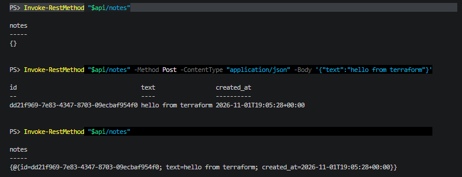
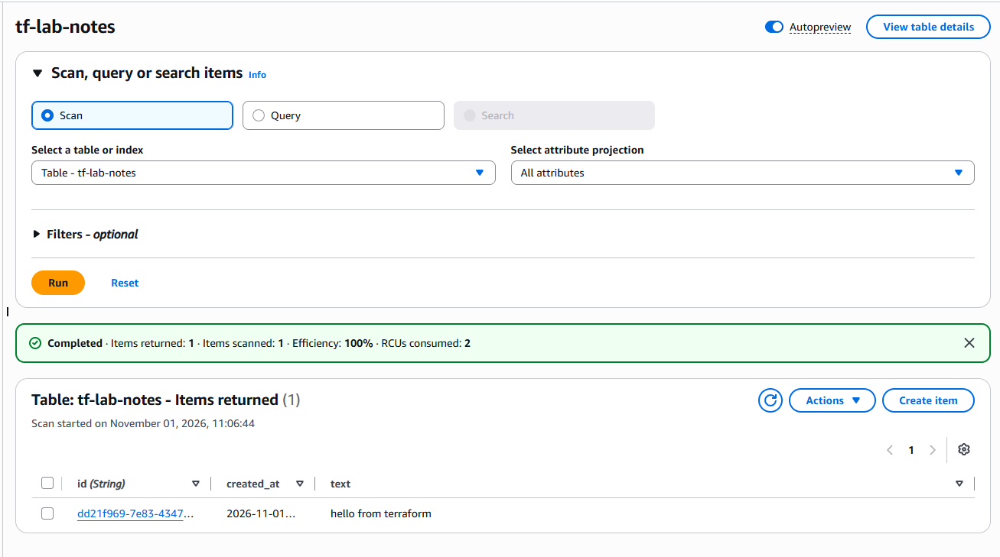
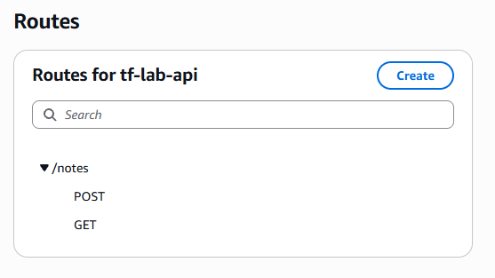
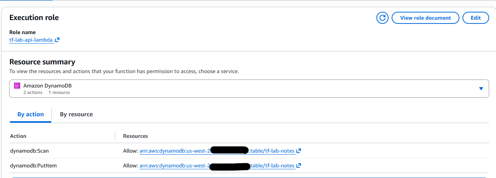
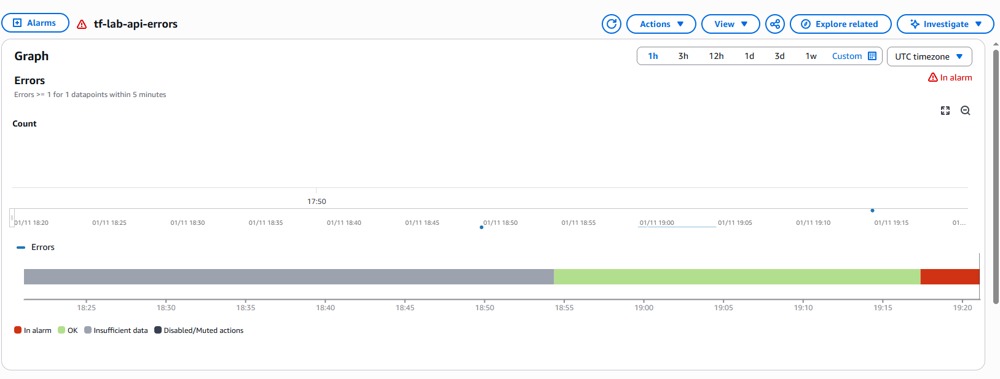

# Terraform AWS Lab

A small serverless app on AWS, defined entirely in Terraform. I built it to get hands-on with AWS while studying for the Solutions Architect Associate exam.

**Status (Nov 1, 2026):** The notes API was deployed, tested and torn down. The CloudFront site is written, but AWS requires new accounts to be verified before they can create CloudFront distributions, so it is waiting on a support case. This is a personal lab, not a production system.

## Architecture

```
Site path:   Visitor -> CloudFront (HTTPS, origin access control) -> private S3 bucket

API path:    Visitor -> API Gateway HTTP API -> Lambda (Python) -> DynamoDB
                                                   |
                                                   +-> CloudWatch logs and error alarm

State:       versioned, encrypted S3 bucket with locking, created once by bootstrap/
```

| Piece | What it does | Why I chose it |
| --- | --- | --- |
| CloudFront + S3 | Serves the static site over HTTPS | The bucket is never public. Origin access control lets only CloudFront read it. |
| API Gateway (HTTP API) | `GET /notes` and `POST /notes`, with throttling | Cheaper and simpler than a REST API, which adds features this app doesn't need |
| Lambda (Python) | Validates input, reads and writes notes | Scales per request and costs nothing while idle |
| DynamoDB (on-demand) | Stores the notes | Simple key-value data, no joins, pay per request |
| IAM role | Lets the Lambda use one table and its own logs, nothing else | Least privilege |
| CloudWatch | Lambda logs, plus an alarm when Errors >= 1 within 5 minutes | Failures are visible without anyone watching |

## Screenshots

| | |
| --- | --- |
| API test from PowerShell |  |
| Note stored in DynamoDB |  |
| API Gateway routes |  |
| Lambda permissions, scoped to one table |  |
| Error alarm firing during the IAM exercise |  |

## What I practiced

- **Remote state and bootstrap.** Terraform can't store state in a bucket that doesn't exist yet, so `bootstrap/` creates the state bucket and budget alert once with local state. `infra/` keeps its state in that bucket and is created and destroyed each session.
- **Reading the plan before every apply.** Every deploy started with `terraform plan`, checking what would be added, changed or destroyed.
- **Debugging IAM from the logs.** I removed `dynamodb:PutItem` from the Lambda's policy and applied. POST requests started returning 500, `aws logs tail` showed the `AccessDeniedException`, and the CloudWatch alarm went into alarm. I restored the permission afterward.
- **Working around a real blocker.** CloudFront creation failed because the account needed verification. Terraform still created every resource that didn't depend on CloudFront, so I deployed and tested the API while the support case was open.
- **A Windows gotcha.** PowerShell splits `-backend-config=backend.hcl` at the dot, so the flag has to be quoted: `'-backend-config=backend.hcl'`.

## Layout

```
bootstrap/   One-time setup: state bucket and budget alert. Local state. Never destroyed.
infra/       The app: frontend (S3 + CloudFront) and the API. Remote state. Destroyed after each session.
lambda/      The Python handler for the API.
site/        Static files for the frontend bucket.
docs/        Screenshots.
```

## Run it yourself (Windows, PowerShell)

Requires Terraform 1.10 or newer, the AWS CLI, and a named profile `tf-lab` for an IAM user (not root) in `us-west-2`.

```powershell
# One time
cd bootstrap
Copy-Item terraform.tfvars.example terraform.tfvars   # add your email for budget alerts
terraform init
terraform apply                                        # note the state_bucket output

# Each session
cd ..\infra
Copy-Item backend.hcl.example backend.hcl              # paste the state bucket name
terraform init '-backend-config=backend.hcl'
terraform plan
terraform apply

$api = terraform output -raw api_url
Invoke-RestMethod "$api/notes" -Method Post -ContentType "application/json" -Body '{"text":"hello"}'
Invoke-RestMethod "$api/notes"

terraform destroy                                      # infra only, never bootstrap
```

## Cost

A session costs pennies. Everything is pay-per-use, there is no NAT Gateway, and the budget alert emails at 50% and 100% of $10.

## Next

- Finish the CloudFront site once AWS verifies the account.
- Have the site call the API and show the notes.
- Replace the DynamoDB scan used for listing with a key design and a query, since a scan reads the whole table.
- GitHub Actions running `fmt`, `validate` and `plan` on pull requests, authenticated with OIDC instead of stored keys.
- Split `infra/` into `static_site` and `api` modules.